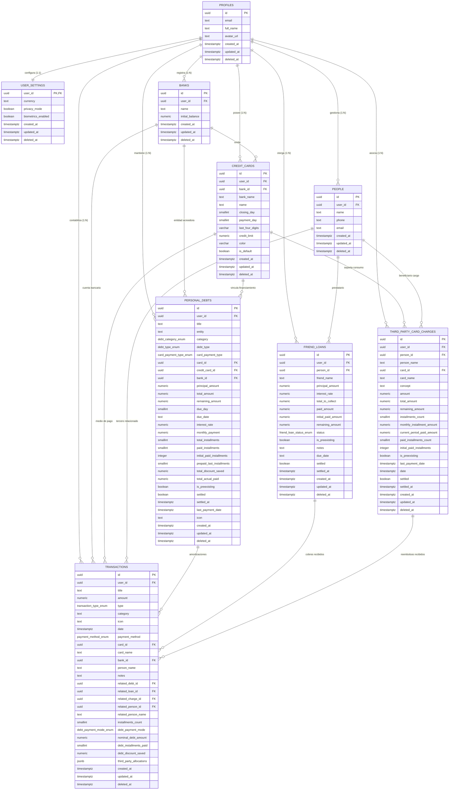

# Especificación Arquitectónica de Base de Datos — ControlFynz
**Motor**: PostgreSQL 15+  
**BaaS / Cloud**: Supabase (Auth, Postgres, Row Level Security, Realtime, Storage)  
**Cliente**: Expo SDK 57 (React Native) con Zustand Offline-First y SafeStorage  
**Versión de Especificación**: 1.0.0  
**Fecha**: Octubre 2026  

---

## 1. Introducción y Arquitectura General

ControlFynz es una plataforma móvil de finanzas personales, gestión de ciclo de tarjetas de crédito, amortización de deudas bancarias, préstamos personales y compras compartidas con terceros. La arquitectura del sistema está diseñada bajo el paradigma **Offline-First**, donde el cliente móvil mantiene disponibilidad operativa total sin conexión a internet y se sincroniza bidireccionalmente con la nube de **Supabase** de manera resiliente, atómica y segura.

```
┌────────────────────────────────────────────────────────────────────────┐
│                   Cliente Móvil (Expo SDK 57)                          │
│                                                                        │
│   ┌────────────────────────────────────────────────────────────────┐   │
│   │  Zustand Stores (Cards, Debts, Transactions, Settings, Auth)   │   │
│   └───────────────────────────────┬────────────────────────────────┘   │
│                                   │                                    │
│   ┌───────────────────────────────▼────────────────────────────────┐   │
│   │  Persistencia Local: SafeStorage (AsyncStorage + Memoria)       │   │
│   │  Generación Determinista de UUID v4 (Crypto.randomUUID)        │   │
│   └───────────────────────────────┬────────────────────────────────┘   │
└───────────────────────────────────┼────────────────────────────────────┘
                                    │ Sincronización Delta Bidireccional
                                    │ (Pull LWW / Push Mutaciones)
┌───────────────────────────────────▼────────────────────────────────────┐
│                   Supabase Cloud (PostgreSQL 15+)                      │
│                                                                        │
│   ┌──────────────────┐  ┌──────────────────┐  ┌──────────────────┐     │
│   │  Supabase Auth   │  │  Row Level Sec.  │  │  Triggers & RPC  │     │
│   │  (auth.users)    │  │  (RLS Policies)  │  │  (ACID Double)   │     │
│   └─────────┬────────┘  └─────────┬────────┘  └─────────┬────────┘     │
│             └─────────────────────┼─────────────────────┘              │
│                                   │                                    │
│   ┌───────────────────────────────▼────────────────────────────────┐   │
│   │  9 Tablas Relacionales Normalizadas (profiles, transactions...) │   │
│   │  Soft-Delete Universal (deleted_at) & Timestamps UTC           │   │
│   └────────────────────────────────────────────────────────────────┘   │
└────────────────────────────────────────────────────────────────────────┘
```

### 1.1. Principios Fundamentales del Diseño

1. **Integridad y Doble Impacto Contable**:  
   Cada amortización de deuda, cobro de préstamo o reembolso de compras compartidas impacta simultáneamente en el libro de transacciones (`transactions`) y en su entidad financiera correspondiente (`personal_debts`, `friend_loans` o `third_party_card_charges`). El esquema relacional cuenta con llaves foráneas y tipos de pago explícitos para permitir trazabilidad y reversión exacta ante eliminaciones.

2. **Seguridad Row Level Security (RLS) Estricta**:  
   Todas las tablas tienen activada la política de seguridad RLS por defecto. Ningún usuario puede leer, insertar, actualizar ni borrar registros cuyo `user_id` no coincida exactamente con `auth.uid()`. El aislamiento multi-inquilino (*multi-tenant*) es inviolable en la capa del motor de base de datos.

3. **Soft Delete Universal (`deleted_at`)**:  
   Las eliminaciones lógicas protegen la integridad referencial histórica del libro contable y permiten propagar eventos de borrado durante la sincronización delta sin requerir tablas auxiliares de lápidas (*tombstones*).

4. **Identificadores UUID v4 Deterministas en Cliente**:  
   Los registros se generan en el cliente con identificadores únicos universales (`Crypto.randomUUID()`) antes de enviarse a la red. Esto elimina viajes de ida y vuelta para conocer IDs autoincrementales, previene colisiones y facilita la escritura offline instantánea.

5. **Mapeo Bidireccional Consistente**:  
   El motor PostgreSQL utiliza la convención canónica `snake_case` con tipos estrictos (`UUID`, `NUMERIC(14, 2)`, `TIMESTAMPTZ`, `SMALLINT`, `BOOLEAN`), mientras que el cliente Expo/Zustand utiliza `camelCase`.

---

## 2. Diagrama Entidad-Relación (ERD Mermaid)

El siguiente diagrama modela las 9 entidades del ecosistema de ControlFynz, sus atributos esenciales y sus relaciones de cardinalidad:



---

## 3. Diccionario de Datos y DDL Completo (SQL)

A continuación se presenta el script DDL ejecutable en Supabase/PostgreSQL.

### 3.1. Extensiones del Sistema y Tipos Enumerados (ENUMs)

```sql
-- Extensiones requeridas para generación y utilidades criptográficas
CREATE EXTENSION IF NOT EXISTS "uuid-ossp";
CREATE EXTENSION IF NOT EXISTS "pgcrypto";

-- Tipos enumerados de negocio
CREATE TYPE transaction_type_enum AS ENUM (
    'income',
    'expense',
    'reimbursement',
    'card_payment'
);

CREATE TYPE payment_method_enum AS ENUM (
    'cash_debit',
    'credit_card'
);

CREATE TYPE debt_category_enum AS ENUM (
    'credit_card',
    'loan',
    'mortgage',
    'other'
);

CREATE TYPE debt_type_enum AS ENUM (
    'credit_card',
    'installment_loan'
);

CREATE TYPE card_payment_type_enum AS ENUM (
    'full_statement',
    'installments'
);

CREATE TYPE friend_loan_status_enum AS ENUM (
    'active',
    'partial',
    'paid'
);

CREATE TYPE debt_payment_mode_enum AS ENUM (
    'next',
    'last'
);

CREATE TYPE currency_code_enum AS ENUM (
    'USD',
    'EUR',
    'BRL',
    'ARS',
    'COP',
    'MXN'
);
```

### 3.2. Función Universal de Actualización de Marcas de Tiempo

```sql
-- Función ejecutada por triggers antes de cada UPDATE para mantener updated_at en UTC
CREATE OR REPLACE FUNCTION trigger_set_updated_at()
RETURNS TRIGGER AS $$
BEGIN
    NEW.updated_at = timezone('utc'::text, now());
    RETURN NEW;
END;
$$ LANGUAGE plpgsql;
```

---

### 3.3. DDL de Tablas Relacionales

#### Tabla 1: `profiles`
Extensión de la identidad del usuario autenticado en `auth.users`.

```sql
CREATE TABLE profiles (
    id UUID PRIMARY KEY REFERENCES auth.users(id) ON DELETE CASCADE,
    email TEXT NOT NULL,
    full_name TEXT,
    avatar_url TEXT,
    created_at TIMESTAMPTZ NOT NULL DEFAULT timezone('utc'::text, now()),
    updated_at TIMESTAMPTZ NOT NULL DEFAULT timezone('utc'::text, now()),
    deleted_at TIMESTAMPTZ,
    CONSTRAINT chk_profiles_email CHECK (email ~* '^[A-Za-z0-9._%+-]+@[A-Za-z0-9.-]+\.[A-Za-z]{2,}$')
);

CREATE TRIGGER set_profiles_updated_at
    BEFORE UPDATE ON profiles
    FOR EACH ROW
    EXECUTE FUNCTION trigger_set_updated_at();
```

#### Tabla 2: `user_settings`
Configuraciones y preferencias de usuario (moneda, privacidad de saldos, biometría).

```sql
CREATE TABLE user_settings (
    user_id UUID PRIMARY KEY REFERENCES profiles(id) ON DELETE CASCADE,
    currency currency_code_enum NOT NULL DEFAULT 'USD',
    privacy_mode BOOLEAN NOT NULL DEFAULT false,
    biometrics_enabled BOOLEAN NOT NULL DEFAULT false,
    created_at TIMESTAMPTZ NOT NULL DEFAULT timezone('utc'::text, now()),
    updated_at TIMESTAMPTZ NOT NULL DEFAULT timezone('utc'::text, now()),
    deleted_at TIMESTAMPTZ
);

CREATE TRIGGER set_user_settings_updated_at
    BEFORE UPDATE ON user_settings
    FOR EACH ROW
    EXECUTE FUNCTION trigger_set_updated_at();

-- Trigger para inicializar profile y user_settings automáticamente tras el registro en Supabase Auth
CREATE OR REPLACE FUNCTION handle_new_user()
RETURNS TRIGGER AS $$
BEGIN
    INSERT INTO public.profiles (id, email, full_name, avatar_url)
    VALUES (
        NEW.id,
        NEW.email,
        NEW.raw_user_meta_data->>'full_name',
        NEW.raw_user_meta_data->>'avatar_url'
    );

    INSERT INTO public.user_settings (user_id, currency, privacy_mode, biometrics_enabled)
    VALUES (NEW.id, 'USD', false, false);

    RETURN NEW;
END;
$$ LANGUAGE plpgsql SECURITY DEFINER;

CREATE OR REPLACE TRIGGER on_auth_user_created
    AFTER INSERT ON auth.users
    FOR EACH ROW EXECUTE FUNCTION handle_new_user();
```

#### Tabla 3: `banks`
Directorio de entidades bancarias registradas por el usuario.

```sql
CREATE TABLE banks (
    id UUID PRIMARY KEY DEFAULT gen_random_uuid(),
    user_id UUID NOT NULL REFERENCES profiles(id) ON DELETE CASCADE,
    name TEXT NOT NULL CHECK (length(trim(name)) > 0),
    initial_balance NUMERIC(12, 2) NOT NULL DEFAULT 0.00,
    created_at TIMESTAMPTZ NOT NULL DEFAULT timezone('utc'::text, now()),
    updated_at TIMESTAMPTZ NOT NULL DEFAULT timezone('utc'::text, now()),
    deleted_at TIMESTAMPTZ
);

-- Garantiza que el usuario no registre el mismo banco dos veces (case-insensitive)
CREATE UNIQUE INDEX idx_banks_unique_name_per_user 
    ON banks (user_id, lower(trim(name))) 
    WHERE deleted_at IS NULL;

CREATE TRIGGER set_banks_updated_at
    BEFORE UPDATE ON banks
    FOR EACH ROW
    EXECUTE FUNCTION trigger_set_updated_at();
```

#### Tabla 4: `credit_cards`
Tarjetas de crédito con modelo dual de fechas: día de corte (`closing_day`) y día de pago (`payment_day`).

```sql
CREATE TABLE credit_cards (
    id UUID PRIMARY KEY DEFAULT gen_random_uuid(),
    user_id UUID NOT NULL REFERENCES profiles(id) ON DELETE CASCADE,
    bank_id UUID REFERENCES banks(id) ON DELETE SET NULL,
    bank_name TEXT NOT NULL CHECK (length(trim(bank_name)) > 0),
    name TEXT NOT NULL CHECK (length(trim(name)) > 0),
    closing_day SMALLINT NOT NULL CHECK (closing_day BETWEEN 1 AND 31),
    payment_day SMALLINT NOT NULL CHECK (payment_day BETWEEN 1 AND 31),
    last_four_digits VARCHAR(4) CHECK (last_four_digits IS NULL OR last_four_digits ~ '^[0-9]{4}$'),
    credit_limit NUMERIC(14, 2) CHECK (credit_limit IS NULL OR credit_limit >= 0),
    color VARCHAR(20) DEFAULT '#00FFA3',
    is_default BOOLEAN NOT NULL DEFAULT false,
    created_at TIMESTAMPTZ NOT NULL DEFAULT timezone('utc'::text, now()),
    updated_at TIMESTAMPTZ NOT NULL DEFAULT timezone('utc'::text, now()),
    deleted_at TIMESTAMPTZ
);

-- Regla de Negocio: Máximo 1 sola tarjeta predeterminada activa por usuario
CREATE UNIQUE INDEX idx_credit_cards_one_default_per_user
    ON credit_cards (user_id)
    WHERE is_default = true AND deleted_at IS NULL;

CREATE TRIGGER set_credit_cards_updated_at
    BEFORE UPDATE ON credit_cards
    FOR EACH ROW
    EXECUTE FUNCTION trigger_set_updated_at();
```

#### Tabla 5: `people`
Directorio centralizado de amigos, prestatarios y contactos para compras compartidas.

```sql
CREATE TABLE people (
    id UUID PRIMARY KEY DEFAULT gen_random_uuid(),
    user_id UUID NOT NULL REFERENCES profiles(id) ON DELETE CASCADE,
    name TEXT NOT NULL CHECK (length(trim(name)) > 0),
    phone TEXT,
    email TEXT,
    created_at TIMESTAMPTZ NOT NULL DEFAULT timezone('utc'::text, now()),
    updated_at TIMESTAMPTZ NOT NULL DEFAULT timezone('utc'::text, now()),
    deleted_at TIMESTAMPTZ
);

-- Garantiza que no existan contactos duplicados por nombre por usuario
CREATE UNIQUE INDEX idx_people_unique_name_per_user
    ON people (user_id, lower(trim(name)))
    WHERE deleted_at IS NULL;

CREATE TRIGGER set_people_updated_at
    BEFORE UPDATE ON people
    FOR EACH ROW
    EXECUTE FUNCTION trigger_set_updated_at();
```

#### Tabla 6: `personal_debts`
Deudas bancarias, préstamos personales y créditos hipotecarios o vehiculares. Soporta amortización tradicional y amortización inversa (adelanto de cuotas desde el final con descuento).

```sql
CREATE TABLE personal_debts (
    id UUID PRIMARY KEY DEFAULT gen_random_uuid(),
    user_id UUID NOT NULL REFERENCES profiles(id) ON DELETE CASCADE,
    title TEXT NOT NULL CHECK (length(trim(title)) > 0),
    entity TEXT NOT NULL CHECK (length(trim(entity)) > 0),
    category debt_category_enum NOT NULL DEFAULT 'other',
    debt_type debt_type_enum DEFAULT 'installment_loan',
    card_payment_type card_payment_type_enum,
    card_id UUID REFERENCES credit_cards(id) ON DELETE SET NULL,
    credit_card_id UUID REFERENCES credit_cards(id) ON DELETE SET NULL,
    bank_id UUID REFERENCES banks(id) ON DELETE SET NULL,
    principal_amount NUMERIC(14, 2) CHECK (principal_amount IS NULL OR principal_amount >= 0),
    is_preexisting BOOLEAN NOT NULL DEFAULT false,
    total_amount NUMERIC(14, 2) NOT NULL CHECK (total_amount >= 0),
    remaining_amount NUMERIC(14, 2) NOT NULL CHECK (remaining_amount >= 0),
    due_day SMALLINT CHECK (due_day IS NULL OR due_day BETWEEN 1 AND 31),
    due_date TEXT NOT NULL,
    interest_rate NUMERIC(6, 2) DEFAULT 0 CHECK (interest_rate >= 0),
    monthly_payment NUMERIC(14, 2) CHECK (monthly_payment IS NULL OR monthly_payment >= 0),
    total_installments SMALLINT CHECK (total_installments IS NULL OR total_installments >= 0),
    paid_installments SMALLINT NOT NULL DEFAULT 0 CHECK (paid_installments >= 0),
    initial_paid_installments INTEGER NOT NULL DEFAULT 0 CHECK (initial_paid_installments >= 0),
    prepaid_last_installments SMALLINT NOT NULL DEFAULT 0 CHECK (prepaid_last_installments >= 0),
    total_discount_saved NUMERIC(14, 2) NOT NULL DEFAULT 0.00 CHECK (total_discount_saved >= 0),
    total_actual_paid NUMERIC(14, 2) NOT NULL DEFAULT 0.00 CHECK (total_actual_paid >= 0),
    settled BOOLEAN NOT NULL DEFAULT false,
    settled_at TIMESTAMPTZ,
    last_payment_date TIMESTAMPTZ,
    icon TEXT NOT NULL DEFAULT 'cash-outline',
    created_at TIMESTAMPTZ NOT NULL DEFAULT timezone('utc'::text, now()),
    updated_at TIMESTAMPTZ NOT NULL DEFAULT timezone('utc'::text, now()),
    deleted_at TIMESTAMPTZ,
    CONSTRAINT chk_personal_debts_amounts CHECK (remaining_amount <= total_amount)
);

CREATE TRIGGER set_personal_debts_updated_at
    BEFORE UPDATE ON personal_debts
    FOR EACH ROW
    EXECUTE FUNCTION trigger_set_updated_at();
```

#### Tabla 7: `friend_loans`
Préstamos otorgados a amigos y familiares (*dinero por cobrar*).

```sql
CREATE TABLE friend_loans (
    id UUID PRIMARY KEY DEFAULT gen_random_uuid(),
    user_id UUID NOT NULL REFERENCES profiles(id) ON DELETE CASCADE,
    person_id UUID REFERENCES people(id) ON DELETE SET NULL,
    friend_name TEXT NOT NULL CHECK (length(trim(friend_name)) > 0),
    principal_amount NUMERIC(14, 2) NOT NULL CHECK (principal_amount >= 0),
    interest_rate NUMERIC(6, 2) NOT NULL DEFAULT 0 CHECK (interest_rate >= 0),
    total_to_collect NUMERIC(14, 2) NOT NULL CHECK (total_to_collect >= 0),
    paid_amount NUMERIC(14, 2) NOT NULL DEFAULT 0.00 CHECK (paid_amount >= 0),
    initial_paid_amount NUMERIC(14, 2) NOT NULL DEFAULT 0.00 CHECK (initial_paid_amount >= 0),
    remaining_amount NUMERIC(14, 2) NOT NULL CHECK (remaining_amount >= 0),
    is_preexisting BOOLEAN NOT NULL DEFAULT false,
    status friend_loan_status_enum NOT NULL DEFAULT 'active',
    notes TEXT,
    due_date TEXT NOT NULL,
    settled BOOLEAN NOT NULL DEFAULT false,
    settled_at TIMESTAMPTZ,
    created_at TIMESTAMPTZ NOT NULL DEFAULT timezone('utc'::text, now()),
    updated_at TIMESTAMPTZ NOT NULL DEFAULT timezone('utc'::text, now()),
    deleted_at TIMESTAMPTZ,
    CONSTRAINT chk_friend_loans_balance CHECK (remaining_amount <= total_to_collect)
);

CREATE TRIGGER set_friend_loans_updated_at
    BEFORE UPDATE ON friend_loans
    FOR EACH ROW
    EXECUTE FUNCTION trigger_set_updated_at();
```

#### Tabla 8: `third_party_card_charges`
Compras realizadas en la tarjeta de crédito del usuario en nombre de un tercero, soportando financiamiento en cuotas y liquidación periódica mensual.

```sql
CREATE TABLE third_party_card_charges (
    id UUID PRIMARY KEY DEFAULT gen_random_uuid(),
    user_id UUID NOT NULL REFERENCES profiles(id) ON DELETE CASCADE,
    person_id UUID REFERENCES people(id) ON DELETE SET NULL,
    person_name TEXT NOT NULL CHECK (length(trim(person_name)) > 0),
    card_id UUID REFERENCES credit_cards(id) ON DELETE SET NULL,
    card_name TEXT NOT NULL CHECK (length(trim(card_name)) > 0),
    concept TEXT NOT NULL CHECK (length(trim(concept)) > 0),
    amount NUMERIC(14, 2) NOT NULL CHECK (amount >= 0),
    total_amount NUMERIC(14, 2) NOT NULL CHECK (total_amount >= 0),
    remaining_amount NUMERIC(14, 2) NOT NULL CHECK (remaining_amount >= 0),
    installments_count SMALLINT NOT NULL DEFAULT 1 CHECK (installments_count >= 1),
    monthly_installment_amount NUMERIC(14, 2) NOT NULL CHECK (monthly_installment_amount >= 0),
    current_period_paid_amount NUMERIC(12, 2) NOT NULL DEFAULT 0.00 CHECK (current_period_paid_amount >= 0),
    paid_installments_count SMALLINT NOT NULL DEFAULT 0 CHECK (paid_installments_count >= 0),
    initial_paid_installments INTEGER NOT NULL DEFAULT 0 CHECK (initial_paid_installments >= 0),
    is_preexisting BOOLEAN NOT NULL DEFAULT false,
    last_payment_date TIMESTAMPTZ,
    date TIMESTAMPTZ NOT NULL DEFAULT timezone('utc'::text, now()),
    settled BOOLEAN NOT NULL DEFAULT false,
    settled_at TIMESTAMPTZ,
    created_at TIMESTAMPTZ NOT NULL DEFAULT timezone('utc'::text, now()),
    updated_at TIMESTAMPTZ NOT NULL DEFAULT timezone('utc'::text, now()),
    deleted_at TIMESTAMPTZ
);

CREATE TRIGGER set_third_party_card_charges_updated_at
    BEFORE UPDATE ON third_party_card_charges
    FOR EACH ROW
    EXECUTE FUNCTION trigger_set_updated_at();
```

#### Tabla 9: `transactions`
Libro diario general de movimientos contables. Centraliza ingresos, gastos y reembolsos con nexos relacionales para trazabilidad y reversión exacta.

```sql
CREATE TABLE transactions (
    id UUID PRIMARY KEY DEFAULT gen_random_uuid(),
    user_id UUID NOT NULL REFERENCES profiles(id) ON DELETE CASCADE,
    title TEXT NOT NULL CHECK (length(trim(title)) > 0),
    amount NUMERIC(14, 2) NOT NULL CHECK (amount >= 0),
    type transaction_type_enum NOT NULL,
    category TEXT NOT NULL CHECK (length(trim(category)) > 0),
    icon TEXT NOT NULL DEFAULT 'wallet-outline',
    date TIMESTAMPTZ NOT NULL DEFAULT timezone('utc'::text, now()),
    payment_method payment_method_enum,
    card_id UUID REFERENCES credit_cards(id) ON DELETE SET NULL,
    card_name TEXT,
    bank_id UUID REFERENCES banks(id) ON DELETE SET NULL,
    person_name TEXT,
    notes TEXT,
    
    -- Nexos relacionales de doble impacto contable
    related_debt_id UUID REFERENCES personal_debts(id) ON DELETE SET NULL,
    related_loan_id UUID REFERENCES friend_loans(id) ON DELETE SET NULL,
    related_charge_id UUID REFERENCES third_party_card_charges(id) ON DELETE SET NULL,
    related_person_id UUID REFERENCES people(id) ON DELETE SET NULL,
    related_person_name TEXT,
    
    -- Metadatos para pagos de cuotas y descuentos en deudas
    installments_count SMALLINT CHECK (installments_count IS NULL OR installments_count >= 1),
    debt_payment_mode debt_payment_mode_enum,
    nominal_debt_amount NUMERIC(14, 2) CHECK (nominal_debt_amount IS NULL OR nominal_debt_amount >= 0),
    debt_installments_paid SMALLINT CHECK (debt_installments_paid IS NULL OR debt_installments_paid >= 0),
    debt_discount_saved NUMERIC(14, 2) CHECK (debt_discount_saved IS NULL OR debt_discount_saved >= 0),
    payment_target TEXT CHECK (payment_target IS NULL OR payment_target IN ('statement', 'partial', 'total')),

    -- Asignaciones atómicas de reembolsos a compras compartidas
    third_party_allocations JSONB NOT NULL DEFAULT '[]'::jsonb,
    
    created_at TIMESTAMPTZ NOT NULL DEFAULT timezone('utc'::text, now()),
    updated_at TIMESTAMPTZ NOT NULL DEFAULT timezone('utc'::text, now()),
    deleted_at TIMESTAMPTZ
);

CREATE TRIGGER set_transactions_updated_at
    BEFORE UPDATE ON transactions
    FOR EACH ROW
    EXECUTE FUNCTION trigger_set_updated_at();
```

##### Documentación del Esquema JSONB para `third_party_allocations` (Snapshots Atómicos)
Para garantizar la reversión exacta e integral de reembolsos aplicados a compras compartidas de terceros (algoritmo en dos fases: liquidación del ciclo corriente y amortización adelantada de cuotas futuras), la columna `third_party_allocations` almacena una lista JSONB con el snapshot del estado previo de cada cargo involucrado:

```json
[
  {
    "chargeId": "d3b07384-d113-4f04-a526-9d629a42142d",
    "appliedAmount": 150.00,
    "previousRemaining": 450.00,
    "previousPaidInstallments": 2,
    "previousCurrentPeriodPaid": 0.00,
    "wasSettled": false
  }
]
```

**Descripción de Campos**:
- `chargeId` (`UUID` string): Identificador único del cargo en `third_party_card_charges`.
- `appliedAmount` (`numeric`): Monto exacto asignado/abonado a este cargo particular dentro de la transacción.
- `previousRemaining` (`numeric`): Saldo pendiente (`remaining_amount`) del cargo previo a la aplicación del abono.
- `previousPaidInstallments` (`integer`): Cantidad de cuotas amortizadas (`paid_installments_count`) antes del abono.
- `previousCurrentPeriodPaid` (`numeric`): Monto abonado en el ciclo actual (`current_period_paid_amount`) previo a la transacción.
- `wasSettled` (`boolean`): Estado booleano de si el cargo ya se encontraba completamente liquidado antes de este pago.
Permite revertir la transacción de manera determinista restaurando exactamente el saldo previo y reactivando cargos en caso de estar liquidados.

---

## 4. Políticas de Seguridad Row Level Security (RLS)

PostgreSQL en Supabase aísla por completo el acceso a los datos mediante RLS. La regla general es que un usuario autenticado solo puede interactuar con filas cuyo `user_id` sea igual a `auth.uid()`.

```sql
-- 1. Habilitación obligatoria de RLS en todas las tablas
ALTER TABLE profiles ENABLE ROW LEVEL SECURITY;
ALTER TABLE user_settings ENABLE ROW LEVEL SECURITY;
ALTER TABLE banks ENABLE ROW LEVEL SECURITY;
ALTER TABLE credit_cards ENABLE ROW LEVEL SECURITY;
ALTER TABLE people ENABLE ROW LEVEL SECURITY;
ALTER TABLE personal_debts ENABLE ROW LEVEL SECURITY;
ALTER TABLE friend_loans ENABLE ROW LEVEL SECURITY;
ALTER TABLE third_party_card_charges ENABLE ROW LEVEL SECURITY;
ALTER TABLE transactions ENABLE ROW LEVEL SECURITY;

-- 2. Políticas para 'profiles'
CREATE POLICY "profiles_owner_access" ON profiles
    FOR ALL
    USING (auth.uid() = id)
    WITH CHECK (auth.uid() = id);

-- 3. Políticas para 'user_settings'
CREATE POLICY "user_settings_owner_access" ON user_settings
    FOR ALL
    USING (auth.uid() = user_id)
    WITH CHECK (auth.uid() = user_id);

-- 4. Políticas para 'banks'
CREATE POLICY "banks_owner_access" ON banks
    FOR ALL
    USING (auth.uid() = user_id)
    WITH CHECK (auth.uid() = user_id);

-- 5. Políticas para 'credit_cards'
CREATE POLICY "credit_cards_owner_access" ON credit_cards
    FOR ALL
    USING (auth.uid() = user_id)
    WITH CHECK (auth.uid() = user_id);

-- 6. Políticas para 'people'
CREATE POLICY "people_owner_access" ON people
    FOR ALL
    USING (auth.uid() = user_id)
    WITH CHECK (auth.uid() = user_id);

-- 7. Políticas para 'personal_debts'
CREATE POLICY "personal_debts_owner_access" ON personal_debts
    FOR ALL
    USING (auth.uid() = user_id)
    WITH CHECK (auth.uid() = user_id);

-- 8. Políticas para 'friend_loans'
CREATE POLICY "friend_loans_owner_access" ON friend_loans
    FOR ALL
    USING (auth.uid() = user_id)
    WITH CHECK (auth.uid() = user_id);

-- 9. Políticas para 'third_party_card_charges'
CREATE POLICY "third_party_card_charges_owner_access" ON third_party_card_charges
    FOR ALL
    USING (auth.uid() = user_id)
    WITH CHECK (auth.uid() = user_id);

-- 10. Políticas para 'transactions'
CREATE POLICY "transactions_owner_access" ON transactions
    FOR ALL
    USING (auth.uid() = user_id)
    WITH CHECK (auth.uid() = user_id);
```

---

## 5. Índices de Alto Rendimiento

Para garantizar respuestas por debajo de 50ms en la aplicación móvil y optimizar la sincronización delta, se aplican los siguientes índices compuestos y parciales:

```sql
-- ============================================================================
-- 5.1. Índices para Sincronización Delta Offline-First (Delta Sync)
-- Permite consultar eficientemente: WHERE user_id = :uid AND updated_at > :last_sync
-- ============================================================================
CREATE INDEX idx_profiles_delta_sync ON profiles (id, updated_at DESC);
CREATE INDEX idx_user_settings_delta_sync ON user_settings (user_id, updated_at DESC);
CREATE INDEX idx_banks_delta_sync ON banks (user_id, updated_at DESC);
CREATE INDEX idx_credit_cards_delta_sync ON credit_cards (user_id, updated_at DESC);
CREATE INDEX idx_people_delta_sync ON people (user_id, updated_at DESC);
CREATE INDEX idx_personal_debts_delta_sync ON personal_debts (user_id, updated_at DESC);
CREATE INDEX idx_friend_loans_delta_sync ON friend_loans (user_id, updated_at DESC);
CREATE INDEX idx_charges_delta_sync ON third_party_card_charges (user_id, updated_at DESC);
CREATE INDEX idx_transactions_delta_sync ON transactions (user_id, updated_at DESC);

-- ============================================================================
-- 5.2. Índices de Negocio y Ciclo de Facturación (Tarjetas)
-- ============================================================================
CREATE INDEX idx_credit_cards_billing_cycle 
    ON credit_cards (user_id, closing_day, payment_day) 
    WHERE deleted_at IS NULL;

-- ============================================================================
-- 5.3. Índices para Libro Diario de Transacciones (Feed por Fecha Descendente)
-- ============================================================================
CREATE INDEX idx_transactions_user_date 
    ON transactions (user_id, date DESC) 
    WHERE deleted_at IS NULL;

CREATE INDEX idx_transactions_type_date 
    ON transactions (user_id, type, date DESC) 
    WHERE deleted_at IS NULL;

-- ============================================================================
-- 5.4. Índices para Estado y Semáforo de Urgencia en Deudas y Préstamos
-- ============================================================================
CREATE INDEX idx_personal_debts_active 
    ON personal_debts (user_id, settled, due_day) 
    WHERE deleted_at IS NULL;

CREATE INDEX idx_friend_loans_active 
    ON friend_loans (user_id, settled, status) 
    WHERE deleted_at IS NULL;

CREATE INDEX idx_charges_active 
    ON third_party_card_charges (user_id, settled, person_id) 
    WHERE deleted_at IS NULL;

CREATE INDEX IF NOT EXISTS idx_third_party_charges_settled_at ON third_party_card_charges(settled_at);
CREATE INDEX IF NOT EXISTS idx_third_party_charges_last_payment ON third_party_card_charges(last_payment_date);

-- ============================================================================
-- 5.5. Índices de Llaves Foráneas para Integridad y Reversión Contable
-- ============================================================================
CREATE INDEX idx_transactions_fk_debt ON transactions (related_debt_id) WHERE related_debt_id IS NOT NULL;
CREATE INDEX idx_transactions_fk_loan ON transactions (related_loan_id) WHERE related_loan_id IS NOT NULL;
CREATE INDEX idx_transactions_fk_charge ON transactions (related_charge_id) WHERE related_charge_id IS NOT NULL;
CREATE INDEX idx_transactions_fk_person ON transactions (related_person_id) WHERE related_person_id IS NOT NULL;
CREATE INDEX idx_transactions_fk_card ON transactions (card_id) WHERE card_id IS NOT NULL;
CREATE INDEX IF NOT EXISTS idx_transactions_bank_id ON transactions(bank_id);
CREATE INDEX idx_charges_fk_card ON third_party_card_charges (card_id) WHERE card_id IS NOT NULL;
CREATE INDEX idx_debts_fk_card ON personal_debts (card_id) WHERE card_id IS NOT NULL;
CREATE INDEX IF NOT EXISTS idx_personal_debts_bank_id ON personal_debts(bank_id);
```

---

## 6. Estrategia y Protocolo de Sincronización Offline-First

### 6.1. Identificadores Deterministas en Cliente (UUID v4)
- **Problema**: En sistemas desconectados, si la base de datos genera los IDs (`SERIAL` o `BIGINT`), el cliente móvil no puede relacionar entidades hijas (como una amortización en `transactions` y su préstamo en `personal_debts`) hasta recibir respuesta de red.
- **Solución ControlFynz**: En Expo/React Native, toda mutación genera su `id` usando `Crypto.randomUUID()` antes de registrarse en Zustand y persistirse en `safeStorage`. Cuando la mutación viaja a Supabase, el `id` ya está resuelto y todas las llaves foráneas entre registros locales son consistentes.

### 6.2. Soft Delete y Trazabilidad Histórica
- **Mecanismo**: Cuando el usuario elimina una transacción, tarjeta o deuda, el store establece:
  ```typescript
  deleted_at: new Date().toISOString()
  ```
- **Sincronización**: El registro marcado con `deleted_at` se sube al backend. Las consultas habituales en el cliente y en la nube filtran `WHERE deleted_at IS NULL`.
- **Beneficio**: Preserva la integridad histórica del libro contable. Una deuda liquidada o eliminada no deja huérfanas transacciones históricas previas.

### 6.3. Resolución de Conflictos Last-Write-Wins (LWW)
- Cada fila cuenta con `updated_at` asignado con tiempo UTC estricto.
- Al producirse un conflicto de sincronización concurrente entre dos dispositivos del mismo usuario, prevalece el registro con el `updated_at` más reciente.
- Si un registro local tiene mutaciones pendientes posteriores a la fecha del servidor, el cliente sobreescribe el estado de la nube durante el *Push*.

### 6.4. Protocolo Bidireccional de Sincronización

```
┌─────────────────┐                                    ┌─────────────────┐
│  Cliente Móvil  │                                    │ Supabase Cloud  │
└────────┬────────┘                                    └────────┬────────┘
         │                                                      │
         │ 1. PULL (Delta Sync)                                 │
         │    GET /rpc/sync_pull(last_sync_timestamp)           │
         ├─────────────────────────────────────────────────────>│
         │    Devuelve registros con updated_at > last_sync     │
         │<─────────────────────────────────────────────────────┤
         │                                                      │
         │ 2. MERGE LOCAL                                       │
         │    Aplica deltas a los stores Zustand (LWW)          │
         │    Actualiza last_sync_timestamp en AsyncStorage     │
         │                                                      │
         │ 3. PUSH (Mutation Queue)                             │
         │    Envía mutaciones locales pendientes en lote       │
         │    POST /rpc/sync_push(mutations_batch)              │
         ├─────────────────────────────────────────────────────>│
         │    Aplica mutaciones en transacción ACID             │
         │    Confirma persistencia                             │
         │<─────────────────────────────────────────────────────┤
         │                                                      │
         │ 4. PURGE QUEUE                                       │
         │    Limpia cola de pendientes local                   │
         v                                                      v
```

1. **Pull (Descarga de deltas)**:
   - El cliente envía su `last_sync_timestamp`.
   - Supabase responde únicamente con filas donde `updated_at > last_sync_timestamp`.
   - El cliente fusiona los cambios en los stores Zustand correspondientes.
2. **Push (Subida de mutaciones locales)**:
   - Las acciones locales se encolan en una lista de mutaciones persistente en `safeStorage`.
   - Cuando se detecta conectividad, se envían en una transacción atómica mediante Supabase RPC o inserciones en lote (*upsert*).
   - Una vez confirmadas por el servidor, la cola local se depura.

### 6.5. Operaciones de Doble Impacto Contable y Atomicidad (RPC)
Para garantizar consistencia absoluta en escenarios con conexión, las mutaciones de doble impacto (ejemplo: registrar abono de deuda que descuenta saldo e inserta una transacción en el libro diario) pueden ejecutarse mediante funciones de base de datos (`SECURITY DEFINER`) transaccionales en PostgreSQL:

```sql
CREATE OR REPLACE FUNCTION record_debt_amortization_atomic(
    p_user_id UUID,
    p_debt_id UUID,
    p_amount NUMERIC(14, 2),
    p_payment_mode debt_payment_mode_enum,
    p_discount_saved NUMERIC(14, 2),
    p_installments_count SMALLINT,
    p_transaction_id UUID,
    p_title TEXT,
    p_date TIMESTAMPTZ
)
RETURNS VOID AS $$
BEGIN
    -- 1. Actualizar el saldo y cuotas de la deuda
    UPDATE personal_debts
    SET 
        remaining_amount = GREATEST(0, remaining_amount - p_amount),
        paid_installments = paid_installments + COALESCE(p_installments_count, 1),
        prepaid_last_installments = CASE 
            WHEN p_payment_mode = 'last' THEN prepaid_last_installments + COALESCE(p_installments_count, 1)
            ELSE prepaid_last_installments 
        END,
        total_discount_saved = total_discount_saved + COALESCE(p_discount_saved, 0),
        total_actual_paid = total_actual_paid + (p_amount - COALESCE(p_discount_saved, 0)),
        last_payment_date = timezone('utc'::text, now()),
        settled = (remaining_amount - p_amount <= 0),
        settled_at = CASE WHEN (remaining_amount - p_amount <= 0) THEN timezone('utc'::text, now()) ELSE NULL END
    WHERE id = p_debt_id AND user_id = p_user_id;

    -- 2. Insertar la transacción correspondiente en el libro diario
    INSERT INTO transactions (
        id,
        user_id,
        title,
        amount,
        type,
        category,
        date,
        payment_method,
        related_debt_id,
        debt_payment_mode,
        nominal_debt_amount,
        debt_discount_saved,
        debt_installments_paid
    ) VALUES (
        p_transaction_id,
        p_user_id,
        p_title,
        (p_amount - COALESCE(p_discount_saved, 0)),
        'expense',
        'debt',
        p_date,
        'cash_debit',
        p_debt_id,
        p_payment_mode,
        p_amount,
        COALESCE(p_discount_saved, 0),
        COALESCE(p_installments_count, 1)
    );
END;
$$ LANGUAGE plpgsql;
```

---

## 7. Resumen de Compatibilidad de Modelos

| Entidad / Tabla | Store Zustand | Interface TypeScript | Claves Foráneas Principales |
|---|---|---|---|
| `profiles` | `useAuthStore` | N/A (Supabase Auth) | `auth.users(id)` |
| `user_settings` | `useSettingsStore` | `SettingsState` | `profiles(id)` |
| `banks` | `useCardsStore` | `Bank` | `profiles(id)` |
| `credit_cards` | `useCardsStore` | `CreditCard` | `profiles(id)`, `banks(id)` |
| `people` | `useDebtsStore` | `PersonContact` | `profiles(id)` |
| `personal_debts` | `useDebtsStore` | `PersonalDebt` | `profiles(id)`, `banks(id)`, `credit_cards(id)` |
| `friend_loans` | `useDebtsStore` | `FriendLoan` | `profiles(id)`, `people(id)` |
| `third_party_card_charges` | `useDebtsStore` | `ThirdPartyCardCharge` | `profiles(id)`, `people(id)`, `credit_cards(id)` |
| `transactions` | `useTransactionsStore` | `Transaction` | `profiles(id)`, `banks(id)`, `credit_cards(id)`, `personal_debts(id)`, `friend_loans(id)`, `third_party_card_charges(id)`, `people(id)` |
